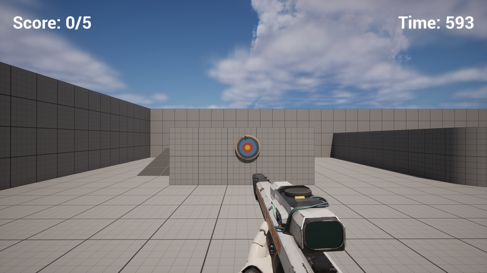
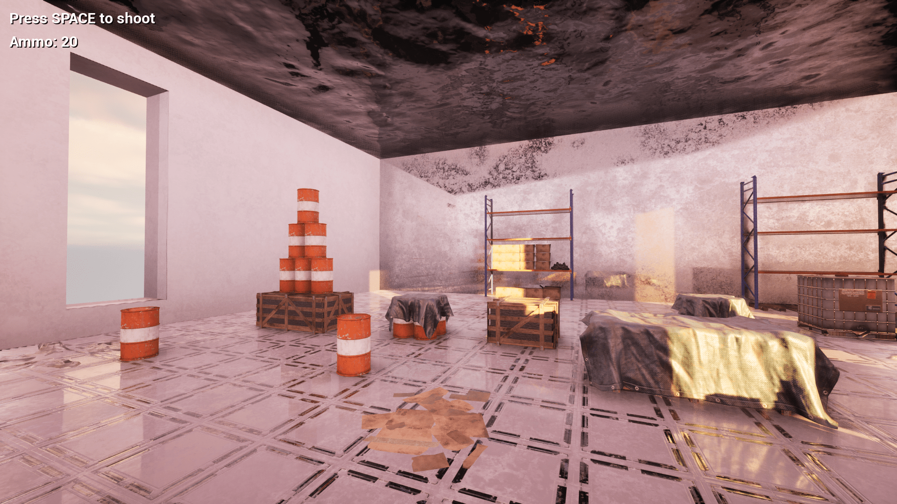
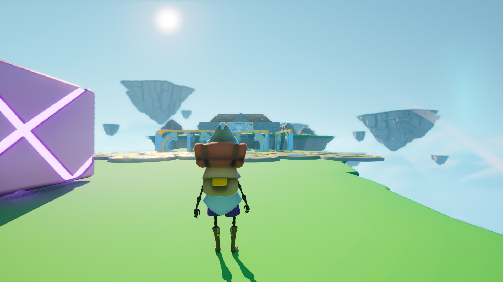
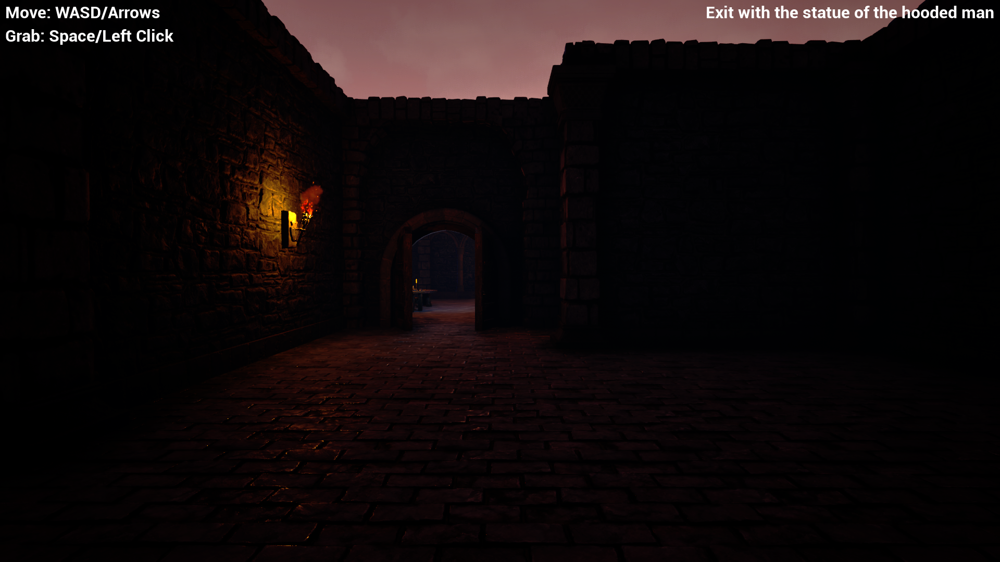

# Unreal Engine 5 tutorials

[Link to the download page (Itch.io)](https://lycorisbellua.itch.io/unreal-tutos)  

### Speed Fire

[Link to the video (YouTube)](https://www.youtube.com/watch?v=D7V08711XVw)  

3D FPS mini-game made with Unreal Engine 5.3.2. The goal is to shoot all the targets before the timer runs out.  

Blueprint project made following a beginner Unreal [tutorial video](https://www.youtube.com/watch?v=1XjgLKrb4_M) by Unreal Sensei.  

### Tumble

[Link to the video (YouTube)](https://www.youtube.com/watch?v=x4kxfi7gX9g)  

3D physics mini-game made with Unreal Engine 5.3.2. Knock everything over!  

Blueprint project made following a beginner Unreal tutorial course by Gamedev.tv:  
[UE5 C++ Developer: Code Your Own Unreal Games](https://gamedev.tv/courses/unreal-5-0-c-developer-learn-c-and-make-video-games)  
superseded by [new version](https://gamedev.tv/courses/unreal-c-dev).  

### Descending Dude

[Link to the video (YouTube)](https://www.youtube.com/watch?v=fpU7Z0kwa-8)  

3D obstacle mini-game made with Unreal Engine 5.3.2. Don't fall off!  

C++ project made following a beginner Unreal tutorial course by Gamedev.tv:  
[UE5 C++ Developer: Code Your Own Unreal Games](https://gamedev.tv/courses/unreal-5-0-c-developer-learn-c-and-make-video-games)  
superseded by [new version](https://gamedev.tv/courses/unreal-c-dev).  

### Professional Yoinker

[Link to the video (YouTube)](https://www.youtube.com/watch?v=YyCMjWYiZ-E)  

3D exploration mini-game made with Unreal Engine 5.3.2. Enter crypt, yoink golden statue, profit.  

C++ project made following a beginner Unreal tutorial course by Gamedev.tv:  
[UE5 C++ Developer: Code Your Own Unreal Games](https://gamedev.tv/courses/unreal-5-0-c-developer-learn-c-and-make-video-games)  
superseded by [new version](https://gamedev.tv/courses/unreal-c-dev).  

### Cara Mia

Link to the video (YouTube)  

3D shooter mini-game made with Unreal Engine 5.3.2. Destroy all the turrets!  

C++ project made following a beginner Unreal tutorial course by Gamedev.tv:  
[UE5 C++ Developer: Code Your Own Unreal Games](https://gamedev.tv/courses/unreal-5-0-c-developer-learn-c-and-make-video-games)  
superseded by [new version](https://gamedev.tv/courses/unreal-c-dev).  

- Insert screenshot here :D  

