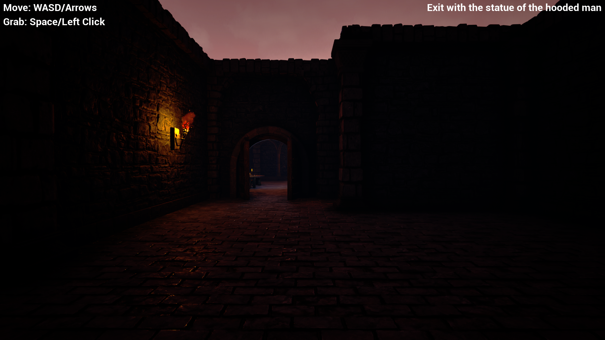

# Professional Yoinker

[Link to the video (YouTube)](https://www.youtube.com/watch?v=YyCMjWYiZ-E)  
[Link to the download page (Itch.io)](https://lycorisbellua.itch.io/unreal-tutos)  

3D exploration mini-game made with Unreal Engine 5.3.2. Enter crypt, yoink golden statue, profit.  

C++ project made following a beginner Unreal tutorial course by Gamedev.tv:  
[UE5 C++ Developer: Code Your Own Unreal Games](https://gamedev.tv/courses/unreal-5-0-c-developer-learn-c-and-make-video-games)  
superseded by [new version](https://gamedev.tv/courses/unreal-c-dev).  

